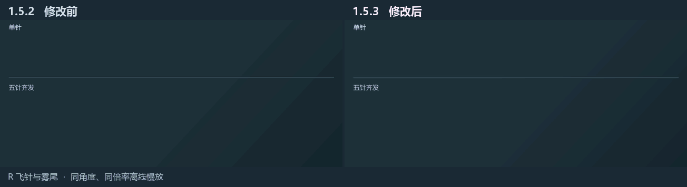

# BLG Gwen · 格温自定义皮肤

白色双马尾里穿着冰蓝和粉色挑染，大剪刀的两片水晶刃也各占一色。W 的雾圈里有 BLG 队标和奖杯，R 的飞针带着蓝粉雾尾。回城时，格温闪到四面队旗前依次剪开它们，登上奖杯摆腿，最后变成 2233 玩偶挥手。

[下载 LTK 皮肤安装包](https://github.com/kazusa000/blg-gwen-skin/releases/latest/download/Gwen1-BLG.fantome) · [下载 v1.5.3 对应的 Blender 工程](https://github.com/kazusa000/blg-gwen-skin/releases/download/v1.5.3/Gwen1-BLG.blend) · [查看所有版本](https://github.com/kazusa000/blg-gwen-skin/releases)

## 工程内容

Blender 母版包含双马尾发束、水晶剪刀、玩偶、材质和动作。[角色贴图](skin/Gwen1/textures) · [技能特效](source/Gwen1/vfx) · [模型导出与回城动画](source/Gwen1/recall)

## 许可与署名

本项目编写的程序代码使用 [MIT 许可证](LICENSE)。格温及游戏素材归 Riot Games，队标、赛事标识、2233 角色和其他第三方美术由各自权利人享有相应权利。BLG Gwen 是玩家自制的免费同人皮肤，未经 Riot Games 或 BLG 官方认可或赞助。[Riot Games 同人创作政策](https://www.riotgames.com/en/legal)
