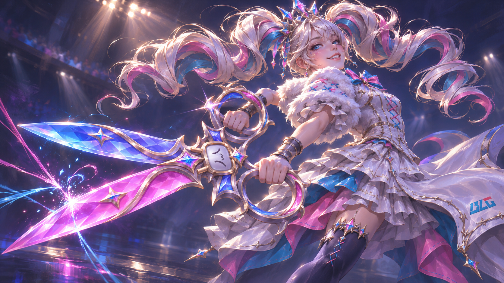

# BLG Gwen · 格温自定义皮肤

白色双马尾里穿着冰蓝和粉色挑染，大剪刀的两片水晶刃也各占一色。W 的雾圈里有 BLG 队标和奖杯，R 的飞针带着蓝粉雾尾。回城时，格温闪到四面队旗前依次剪开它们，登上奖杯摆腿，最后变成 2233 玩偶挥手。

[下载 LTK 皮肤安装包](https://github.com/kazusa000/blg-gwen-skin/releases/latest/download/Gwen1-BLG.fantome) · [下载 v1.5.3 对应的 Blender 工程](https://github.com/kazusa000/blg-gwen-skin/releases/download/v1.5.3/Gwen1-BLG.blend) · [查看所有版本](https://github.com/kazusa000/blg-gwen-skin/releases)

## 用 LTK Manager 安装

1. 下载上面的 **Gwen1-BLG.fantome**。从 Release 页面下载时，在 **Assets** 里选择同名文件。
2. 打开 LTK Manager，首次使用时选好本机《英雄联盟》游戏目录。把安装包拖进窗口，或按 **Ctrl+I** 导入。[LTK Manager](https://github.com/LeagueToolkit/ltk-manager/releases/latest)
3. 在当前配置中启用 **BLG Gwen**，关闭其他替换格温默认外观的模组，点击 **Start**。
4. 保持 LTK Manager 运行，在游戏里选择**格温的默认外观**。训练模式里可以用 Q、W、E、R 看技能效果，按 Ctrl+1 看玩偶，按 B 看完整回城。

## 编辑工程

用 Blender 5.1 打开 Release 中的完整母版，可以编辑双马尾发束、剪刀、玩偶、材质和动作。可编辑贴图在 [skin/Gwen1/textures](skin/Gwen1/textures)。技能发射器、投射物和粒子美术在 [source/Gwen1/vfx](source/Gwen1/vfx)，模型导出、回城和完整皮肤打包在 [source/Gwen1/recall](source/Gwen1/recall)。从母版构建及检验安装包的步骤见[构建说明](BUILD.md)。

## 许可与署名

本项目编写的程序代码使用 [MIT 许可证](LICENSE)。格温及游戏素材归 Riot Games，队标、赛事标识、2233 角色和其他第三方美术由各自权利人享有相应权利。BLG Gwen 是玩家自制的免费同人皮肤，未经 Riot Games 或 BLG 官方认可或赞助。[Riot Games 同人创作政策](https://www.riotgames.com/en/legal)
